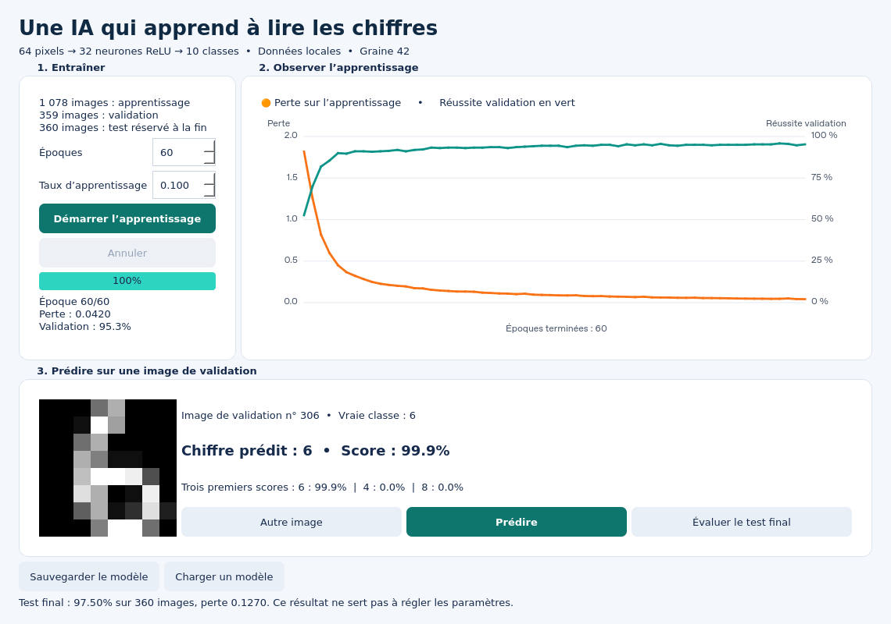

# Cours IA : créer un réseau de neurones en Python

Un cours en français de **32 diapositives**, accompagné d’exercices corrigés et
d’une petite interface graphique pour entraîner un réseau à reconnaître des
chiffres manuscrits.

## Accès direct

- **[Télécharger le PowerPoint](livrables/Cours_IA_Python_Reseau_Neurones.pptx)**
- **[Lire le cours en PDF](livrables/Cours_IA_Python_Reseau_Neurones.pdf)**
- **[Exercices et corrigés](EXERCICES_ET_CORRIGES.md)**
- **[Code Python et installation](code/README.md)**
- [Guide complet du cours](LIRE_MOI.md)

Sur GitHub, utiliser le bouton de téléchargement du fichier pour récupérer le
PowerPoint. Les notes du présentateur contiennent les explications détaillées.

## Le projet

Le réseau est programmé avec NumPy : **64 entrées → 32 neurones ReLU → 10 sorties
softmax**. scikit-learn fournit les données ; PySide6 fournit l’interface.
Le cours explique les poids, la propagation avant, la rétropropagation,
l’entraînement et la séparation apprentissage / validation / test.

Le dossier `support` contient les mesures de référence, les figures, les poids
du modèle entraîné et le script de génération du PowerPoint. Les fichiers
`requirements.txt` de `code` et `requirements-generation.txt` de `support`
correspondent à deux usages distincts : exécuter l’application ou régénérer le cours.

Les six tests du modèle réussissent. L’expérience de référence atteint **97,5 %**
sur les 360 images réservées au test ; ce résultat n’est pas une garantie sur
d’autres images. Consulter le guide complet pour les commandes et les limites.
