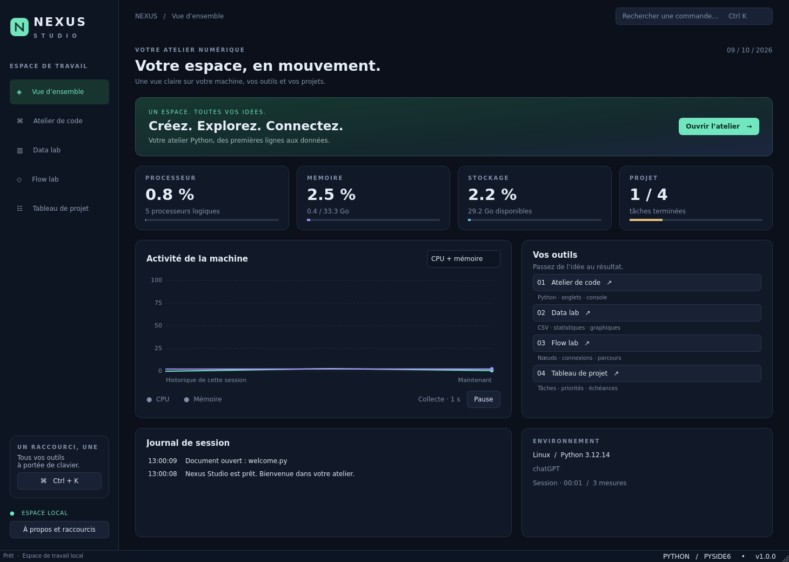

# Nexus Studio

**Nouveau : [cours d’IA en Python](IA/README.md)** — PowerPoint, PDF, exercices
corrigés et code d’un réseau de neurones avec interface graphique dans le dossier `IA`.

Un atelier graphique Python complet, en français, construit avec **PySide6 / Qt 6** : cinq espaces de travail, une interface sombre, des graphiques vectoriels et des données conservées localement.



## Lancer l’application

Python **3.10 à 3.13** et une session de bureau sont nécessaires pour afficher la fenêtre. Les dépendances sont fixées dans `requirements.txt`. Le projet a été validé ici sous Linux avec Python 3.12 et Qt hors écran ; Windows et macOS n’ont pas été testés dans cet environnement.

Depuis le dossier du projet, sous Windows :

```powershell
py -m venv .venv
.venv\Scripts\python.exe -m pip install -r requirements.txt
.venv\Scripts\python.exe main.py
```

Sous Linux ou macOS :

```bash
python3 -m venv .venv
.venv/bin/python -m pip install -r requirements.txt
.venv/bin/python main.py
```

Le script `bash scripts/setup.sh` effectue aussi l’installation sur Linux/macOS. Sous Linux, Qt utilise la session X11/Wayland disponible et ses bibliothèques système ; un serveur sans bureau peut exécuter les tests hors écran ci-dessous.

Pour ouvrir un autre dossier dans l’explorateur :

```bash
.venv/bin/python main.py --workspace /chemin/vers/mon-projet
```

## Les cinq espaces

| Espace | Fonctions |
| --- | --- |
| **Vue d’ensemble** | Mesures réelles CPU, mémoire et disque via psutil ; historique de 120 mesures, courbes et survol, pause/reprise, progression des tâches et journal d’activité. Les mesures décrivent le système exposé par le système d’exploitation, qui peut différer des quotas d’un conteneur. |
| **Atelier de code** | Explorateur de fichiers, onglets, coloration Python avec chaînes multilignes, numéros de ligne, indentation/désindentation, recherche, sauvegarde atomique, confirmation des changements non enregistrés, exécution Python asynchrone, console UTF-8 et arrêt du processus. |
| **Data lab** | Jeu de démonstration de 240 observations, import CSV/TSV UTF-8, détection du séparateur, tri numérique, filtre global, statistiques calculées sur les lignes visibles, dispersion, courbe et histogramme, export de la vue filtrée et triée. |
| **Flow lab** | Cartes déplaçables, connexions courbes, zoom, déplacement du canevas, inspecteur, ajout/suppression/renommage, import/export JSON validé, parcours en largeur animé avec gestion des cycles et des composantes isolées. |
| **Tableau de projet** | Kanban à trois colonnes, création/édition/suppression, descriptions, priorités, échéances, recherche, filtres et déplacement par sélection du statut. Sauvegarde SQLite immédiate. |

La palette **Ctrl+K** cherche les pages et les actions ; les flèches permettent de choisir un résultat, Entrée l’ouvre. Les séparateurs de l’éditeur et des laboratoires sont redimensionnables.

### Raccourcis

| Raccourci | Action |
| --- | --- |
| Ctrl+1 à Ctrl+5 | Changer d’espace |
| Ctrl+K | Palette de commandes |
| Ctrl+N / Ctrl+O | Nouveau document / ouvrir, dans l’éditeur |
| Ctrl+S / Ctrl+Maj+S | Enregistrer / enregistrer sous |
| Ctrl+F | Rechercher dans le document |
| F5 / Maj+F5 | Exécuter / arrêter le script |
| Tab / Maj+Tab | Indenter / désindenter dans l’éditeur |
| Suppr | Supprimer la carte sélectionnée du graphe |

Les raccourcis standards de Qt utilisent les conventions du système, notamment Command sur macOS pour les actions standard d’édition.

## Données et fonctionnement

Les tâches sont enregistrées dans `tasks.sqlite3`. Le graphe et la disposition de la fenêtre sont sauvegardés à la fermeture dans `graph.json` et `session.json`. Leur dossier est fourni par `QStandardPaths.AppLocalDataLocation` ; **À propos et raccourcis** affiche le chemin exact. Vous pouvez choisir un dossier explicite :

```bash
.venv/bin/python main.py --state-dir .nexus-state
```

Les cartes de démonstration du Kanban sont ajoutées uniquement à la création de la base. Le graphe est restauré au prochain lancement. Les documents de l’éditeur se sauvegardent avec Ctrl+S ; les onglets et les CSV ouverts ne sont pas restaurés automatiquement. Les fichiers CSV importés restent inchangés et l’export écrit un fichier choisi par l’utilisateur.

L’exécution dans l’éditeur lance le même interpréteur Python que Nexus, avec le dossier de travail choisi. Elle exécute réellement le code avec les droits de l’utilisateur. La console reçoit stdout/stderr, mais ne propose pas d’entrée interactive pour `input()`. Arrêter termine le processus lancé ; les éventuels processus enfants créés par votre script ne sont pas gérés comme un groupe. Le Flow lab anime la structure du graphe : il ne transforme pas de données et n’envoie aucune requête réseau.

Les limites évitent de bloquer l’interface : éditeur à 5 Mio par fichier, console à 3 000 lignes et environ 500 000 caractères, CSV à 16 Mio et 80 colonnes. Au-delà de 25 000 lignes, l’import CSV affiche un aperçu explicitement signalé ; les statistiques et l’export concernent cet aperçu. Les nuages/courbes affichent au plus 1 200 points. Les graphes acceptent jusqu’à 300 nœuds et 3 000 liens. Les imports CSV sont synchrones et destinés aux jeux de taille modérée.

## Vérification sans écran

Les tests utilisent `unittest`, sans dépendance de test supplémentaire. Ils vérifient les valeurs exportées, la validation atomique des imports, les écritures SQLite et la restauration, les parcours de graphes, les connexions déplacées, l’exécution Python réelle, stdout/stderr, l’arrêt et les codes de sortie, ainsi que la navigation et le rendu des cinq pages.

```bash
QT_QPA_PLATFORM=offscreen XDG_CACHE_HOME=/tmp/nexus-cache \
  .venv/bin/python -m unittest discover -s tests -v
```

Pour démarrer la vraie fenêtre, la rendre, enregistrer sa session et fermer automatiquement :

```bash
QT_QPA_PLATFORM=offscreen XDG_CACHE_HOME=/tmp/nexus-cache \
  .venv/bin/python main.py --state-dir /tmp/nexus-validation \
  --smoke-test --screenshot /tmp/nexus.png
```

`offscreen` vérifie le rendu Qt sans afficher une fenêtre sur votre écran. Lancez normalement `main.py` sur un ordinateur disposant d’une session graphique pour utiliser l’application.

## Organisation du code

```text
main.py                 Point d’entrée
nexus/
  app.py                Fenêtre, navigation, commandes et session
  theme.py              Palette et styles Qt
  dashboard.py          Mesures système et tracés vectoriels
  editor.py             Éditeur, coloration et processus Python
  data_lab.py           Modèle CSV, filtres, statistiques et graphiques
  graph_lab.py          Scène, nœuds, connexions et parcours animé
  tasks.py              Stockage SQLite, formulaires et Kanban
examples/welcome.py     Exemple exécutable avec F5
tests/                  Tests unitaires et intégration Qt
scripts/setup.sh        Installation reproductible
```

L’architecture repose sur les signaux/slots Qt, `QAbstractTableModel`, `QSortFilterProxyModel`, `QGraphicsScene`, `QPainter`, `QProcess`, `QTimer` et les transactions SQLite. Elle sépare chaque outil de la fenêtre principale pour faciliter son extension.
